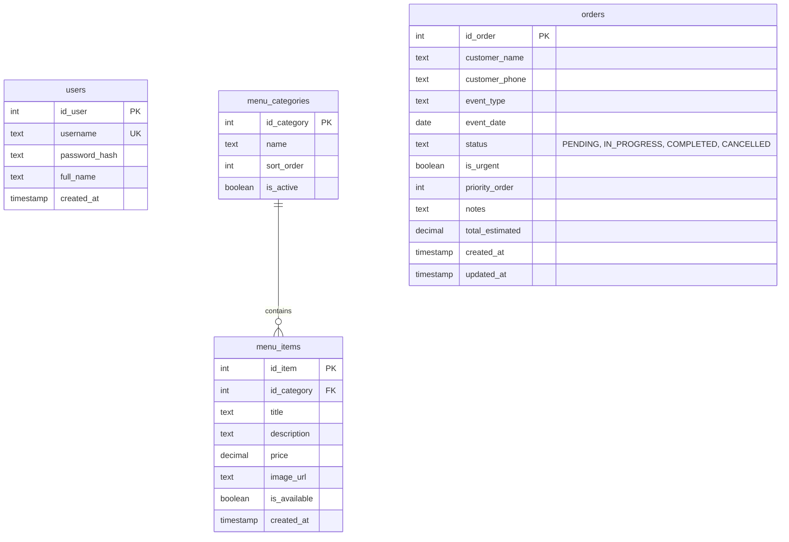

# Especificación Técnica y Arquitectura: Catering Admin & Menú

Este documento define los requerimientos, el modelo de datos, la arquitectura y el plan de implementación para el sistema de administración de Catering.

---

## 1. Alcance y Módulos

### Módulo 1: Menú Público (Sin autenticación)
- Acceso libre para cualquier usuario/cliente.
- Vista de catálogo de platillos/servicios de catering (categorías, descripciones, precios, fotos/etiquetas).
- Todo el copy, nombre del negocio, contacto y textos del encabezado provienen del archivo XML de configuración.

### Módulo 2: Panel de Administración (Privado)
- **Autenticación:** JWT propio en .NET 10 con tabla `users` (contraseñas con hash bcrypt).
- **Gestión de Menú (CRUD):**
  - Crear, editar, ocultar/desactivar y eliminar platillos y paquetes de catering.
- **Gestión de Pedidos Manuales:**
  - Tablero estilo **Kanban** visual con columnas:
    - *Pendiente*
    - *En Proceso*
    - *Completado*
  - Indicador visual de **Urgencia** (badge/color destacado) y reordenamiento.
  - Histórico de pedidos terminados/archivados con búsqueda y filtros.

### Módulo 3: Cotizador (En Espera)
- Módulo placeholder / pendiente hasta recibir la documentación y reglas de negocio del cliente.

### Requerimiento Transversal: Configuración por XML en Frontend
- Archivo XML (`public/content/site-content.xml`) que centraliza:
  - Nombre de la marca / negocio.
  - Slogan y subtítulo.
  - Enlaces de contacto (WhatsApp, redes, email).
  - Textos de banners y secciones públicas.
- Proveedor / hook React (`useSiteContent`) que parsea el XML y ofrece tipado para consumirlo en toda la UI.

### Estilo e Interfaz: ShadCN UI + Lucide React
- 100% componentes de ShadCN UI (Tailwind CSS, Radix UI primitives).
- Iconografía con `lucide-react`.

---

## 2. Modelo de Base de Datos (Flyway en `sql/`)

---

## 3. Plan de Fases de Construcción

1. **Fase 1: Base de Datos y Migraciones Flyway**
   - Script `V001__init_schema.sql` (tablas: `users`, `menu_categories`, `menu_items`, `orders`).
   - Script `V002__seed_admin_and_demo_menu.sql` (usuario admin inicial y categorías base).
   - Script `R__010_fn_orders.sql` / funciones auxiliares si se requieren.

2. **Fase 2: Backend .NET 10**
   - **`AngelCathering.Models`**: Entidades y DTOs para Auth, Menú y Pedidos.
   - **`AngelCathering.Data`**: Factoría de conexión PostgreSQL y helpers Dapper.
   - **`AngelCathering.Repository`**: Repositorios para `UserRepository`, `MenuRepository`, `OrderRepository`.
   - **`AngelCathering.Api`**: Endpoints Minimal API (Auth/JWT, Menú público, Menú admin, Pedidos/Kanban).

3. **Fase 3: Frontend con ShadCN UI + Vite React**
   - Configuración de Tailwind CSS y CLI de ShadCN UI.
   - Sistema de parseo de XML para contenidos/copy (`site-content.xml`).
   - Vistas públicas: Menú y contacto.
   - Vistas privadas: Login, Tablero Kanban de pedidos, CRUD de menú y placeholder de cotización.
