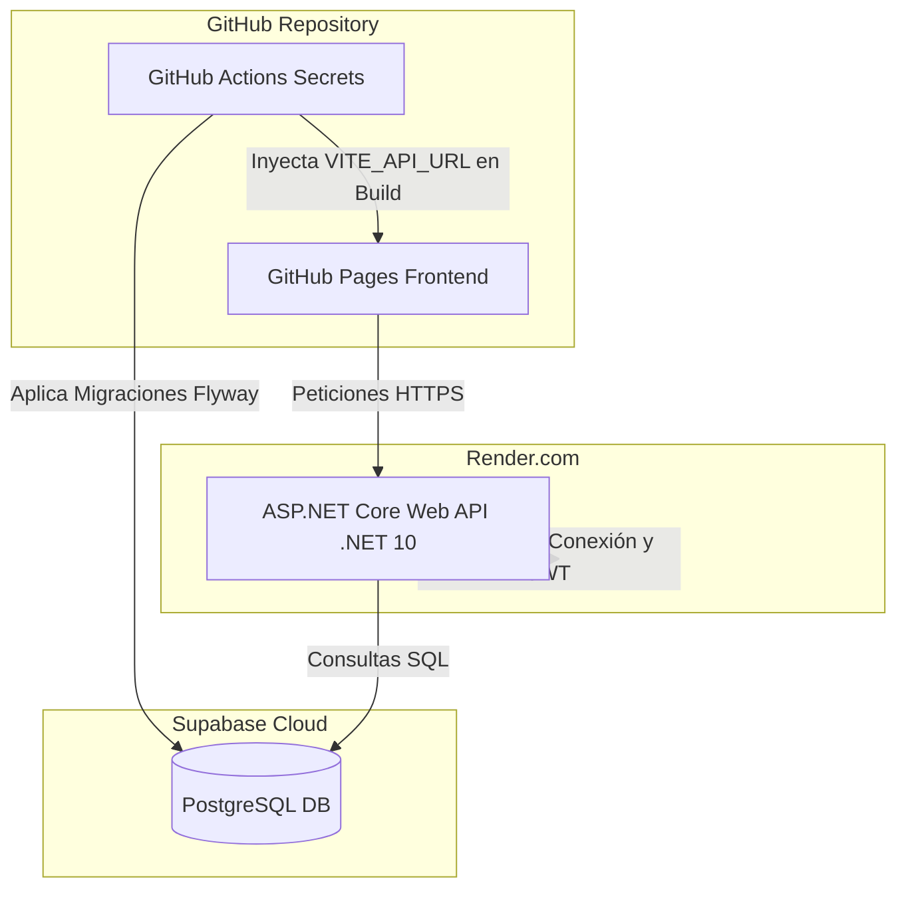

# Guía de Configuración: GitHub Secrets, Supabase y Render

Esta guía te indica con exactitud qué variables y secretos debes registrar tanto en **GitHub Secrets** como en **Render** para que el flujo de CI/CD, las migraciones automáticas en Supabase y el frontend en GitHub Pages funcionen sin exponer ninguna credencial.

---

## 1. Dónde va cada secreto y variable



---

## 2. GitHub Secrets (Settings > Secrets and variables > Actions)

En tu repositorio de GitHub, ve a **Settings** ➔ **Secrets and variables** ➔ **Actions** ➔ botón **New repository secret**:

| Nombre del Secreto (Exacto) | ¿Qué valor poner? | ¿Para qué se usa? |
|---|---|---|
| `FLYWAY_URL` | `jdbc:postgresql://<host-supabase>:5432/postgres?sslmode=require` | Conexión JDBC que usa el Action de Flyway para conectarse a Supabase. *(Obtenible en Supabase > Project Settings > Database > Connection string > JDBC o URI transformado)*. |
| `FLYWAY_USER` | `postgres` (o tu usuario con pooler, ej: `postgres.<project-id>`) | Usuario administrador de la BD de Supabase. |
| `FLYWAY_PASSWORD` | `<tu-contraseña-de-supabase>` | Contraseña maestra de la base de datos de Supabase. |
| `VITE_API_URL` | `https://tu-servicio-en-render.onrender.com` | URL pública donde quedará desplegada la API en Render (se inyecta al compilar el frontend para GitHub Pages). |

> [!NOTE]
> Con estos secretos configurados, cada vez que hagas `git push` a `main` con cambios en `sql/`, el workflow `.github/workflows/db-migrate.yml` ejecutará las migraciones de Flyway directamente sobre tu base de datos de Supabase.

---

## 3. Variables de Entorno en Render.com (para el Backend)

Cuando crees tu **Web Service** en [Render.com](https://render.com):
- **Tipo de entorno**: *Docker* (Render detecta automáticamente el `Dockerfile` de .NET 10 que preparamos en `AngelCathering.Api/Dockerfile`).
- **Plan**: *Free*.
- **En la pestaña "Environment Variables" de Render**, agrega las siguientes:

| Clave (Key) | Valor Sugerido | Descripción |
|---|---|---|
| `CONNECTION_STRING` | `Host=<host-supabase>;Port=5432;Database=postgres;Username=postgres;Password=<tu-password>;SSL Mode=Require;Trust Server Certificate=true;` | Cadena de conexión ADO.NET / Npgsql para que .NET 10 se conecte a Supabase con SSL. |
| `JWT_SECRET` | Una cadena secreta y aleatoria de al menos 32 caracteres (ej: `RoseCatering_SuperSecret_Production_Key_2026_SecureRandom!`) | Llave criptográfica para firmar los tokens de sesión. |
| `JWT_ISSUER` | `rosecatering-api` | Identificador del emisor del token. |
| `JWT_AUDIENCE` | `rosecatering-app` | Identificador de la audiencia permitida. |
| `ALLOWED_ORIGINS` | `https://<tu-usuario-gh>.github.io` | Tu URL de GitHub Pages para permitir llamadas CORS exclusivas y seguras desde tu frontend. |
| `ASPNETCORE_ENVIRONMENT` | `Production` | Indica a .NET que corra con optimizaciones y restricciones de producción. |

---

## 4. Activación de GitHub Pages

1. En tu repositorio de GitHub, ve a **Settings** ➔ **Pages**.
2. En **Build and deployment** > **Source**, selecciona: **GitHub Actions**.
3. El workflow `.github/workflows/deploy-pages.yml` se encargará automáticamente del resto en cada push.

---

## 5. Pasos para Subir el Repositorio a GitHub

Ejecuta en tu terminal local (sustituyendo tu usuario y nombre de repo):

```bash
# 1. Agregar el origen remoto de GitHub
git remote add origin https://github.com/<tu-usuario>/<tu-repo>.git

# 2. Subir la rama principal
git push -u origin main
```
