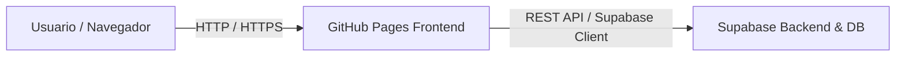

# Plan de Implementación: Web Rápida con CRUD y Despliegue Gratuito

Este documento detalla la arquitectura, herramientas y el paso a paso para crear y desplegar un CRUD sencillo de forma rápida y 100% gratuita.

---

## 1. Arquitectura Recomendada (100% Gratuita)

| Capa | Servicio / Herramienta | Justificación |
|---|---|---|
| **Frontend** | **GitHub Pages** (Vite + React o Vanilla HTML/JS + Tailwind CSS) | Hospedaje estático gratuito, integración directa con Git y despliegue automático mediante GitHub Actions. |
| **Backend & Base de Datos** | **Supabase** (o alternativamente **MockAPI / Render / Firebase**) | Ofrece base de datos PostgreSQL, API REST autogenerada al instante, autenticación y CRUD completo sin programar backend tradicional. |

> [!TIP]
> **¿Por qué Supabase para un CRUD rápido?**  
> Elimina la necesidad de crear un servidor Node.js/Python, lidiar con CORS o configurar bases de datos. Creas la tabla en su dashboard y tienes endpoints REST listos con clientes JavaScript oficiales.

---

## 2. Flujo del Proyecto

---

## 3. Fases de Implementación

### Fase 1: Configurar el Backend (Supabase) (~5-10 min)
1. **Crear cuenta y proyecto:**
   - Registrarse en [supabase.com](https://supabase.com).
   - Crear un nuevo proyecto gratuito.
2. **Crear la tabla del CRUD (ejemplo: `pedidos` o `items`):**
   - Campos sugeridos:
     - `id` (uuid o int8, primary key)
     - `created_at` (timestamp, default `now()`)
     - `nombre` (text)
     - `descripcion` (text)
     - `estado` (text)
3. **Configurar políticas de acceso (RLS):**
   - Para una prueba rápida sin login, habilitar acceso público de lectura/escritura (o desactivar temporalmente RLS para pruebas).
4. **Obtener credenciales:**
   - Copiar `Project URL` y `anon public API Key` (disponibles en Project Settings > API).

---

### Fase 2: Desarrollo del Frontend (~15-20 min)
1. **Inicializar el proyecto:**
   - Opciones:
     - **Opción A (Ultra rápida):** Un solo archivo `index.html` con Tailwind CSS (vía CDN) y `@supabase/supabase-js` (vía script/CDN).
     - **Opción B (Estructurada):** Proyecto con Vite + React / Vanilla JS (`npm create vite@latest`).
2. **Implementar interfaz CRUD:**
   - **Create:** Formulario para agregar nuevos registros.
   - **Read:** Tabla o listado de elementos con indicador de carga (*loading*).
   - **Update:** Modal o edición en línea para modificar un registro.
   - **Delete:** Botón para eliminar con confirmación.
3. **Conectar cliente API:**
   - Integrar llamadas con `supabase.from('items').select()`, `.insert()`, `.update()`, `.delete()`.

---

### Fase 3: Publicación en GitHub Pages (~5 min)
1. **Crear repositorio en GitHub:**
   - Subir el código fuente a la rama `main`.
2. **Configuración de despliegue:**
   - **Si es HTML puro:**  
     Ir a *Settings > Pages* en el repositorio de GitHub y seleccionar la rama `main` y carpeta `/ (root)`.
   - **Si es con Vite:**  
     Configurar `base: '/<nombre-del-repo>/'` en `vite.config.js` y utilizar un workflow de GitHub Actions (`pages.yml`) para compilar (`npm run build`) y publicar la carpeta `dist`.
3. **Verificación:**
   - Abrir la URL `https://<usuario>.github.io/<repositorio>/`.
   - Realizar pruebas de creación, lectura, actualización y borrado.

---

## 4. Alternativas de Backend Gratuito

Si prefieres programar tu propia API:
- **Render.com / Railway:** Aloja una API en Express.js / FastAPI gratis (Render tiene *cold start* en plan gratuito de ~50 seg de espera tras inactividad).
- **Firebase Firestore:** Alternativa similar a Supabase respaldada por Google Cloud.
- **MockAPI.io:** Ideal si solo requieres probar la UI con datos simulados sin configurar base de datos real.

---

## 5. Próximos Pasos

1. ¿Deseas que implementemos el frontend con **Vite + React** o **HTML/JS puro con Tailwind CDN** para que quede listo inmediatamente?
2. ¿Prefieres usar **Supabase** o una API en **Node.js/Express**?
